> **[Read documentation in English](./README.md)**

# AEGIS // GATEWAY — Proxy AI Empresarial, Firewall Zero-Trust y Plataforma FinOps (V2.0)

**AEGIS // GATEWAY** es una plataforma de control y proxy AI de código abierto compatible con el estándar OpenAI (`/v1/chat/completions`, `/v1/models`), diseñada para cargas empresariales en producción. Autentica clientes con **Virtual API Keys SHA-256**, optimiza costos dinámicamente mediante **`aegis-auto` (Smart Cost-Aware Router)**, bloquea inyecciones y anonimiza PII en tiempo real, garantiza alta disponibilidad con **Circuit Breakers y Failover Automático**, soporta **salidas JSON (`response_format`) y `tool_calls` agénticos**, y audita la postura de seguridad con un **Benchmark Red-Team OWASP LLM** en 1 clic.

---

## Arquitectura del Sistema

```mermaid
flowchart LR
    Client["Cliente / SDK OpenAI / Agente"] -->|"Bearer ag-live-... o X-Aegis-Tenant"| Auth["Resolvedor Virtual Key SHA-256"]
    Auth -->|"HTTP 401 si es inválida/revocada"| Reject401["Acceso Denegado"]
    Auth --> RateGuard["Rate Limiter RPM & Presupuesto Diario USD"]
    RateGuard -->|"HTTP 429 si excede cuota"| Reject429["Cuota / Presupuesto Agotado"]
    RateGuard --> InjFirewall["Firewall Pre-Flight de Injection y Jailbreak"]
    InjFirewall -->|"risk_score >= umbral (HTTP 403)"| AuditBlocked["Traza Auditada (BLOCKED)"]
    InjFirewall --> DLP["Motor DLP & Enmascaramiento PII (Luhn, Cédula/SSN, API Keys)"]
    DLP --> SmartRouter{"Smart Cost Router (aegis-auto) & Circuit Breaker"}
    SmartRouter -->|"Simple -> gemini-2.5-flash (cost-optimized)"| SemCache{"Caché Semántico (Similitud Coseno >= 0.92)"}
    SmartRouter -->|"Complejo -> gpt-4o / Failover por Caída"| SemCache
    SemCache -->|"Cache Hit (< 15 ms, $0.00)"| ResponseHit["Respuesta JSON o Stream SSE + X-Aegis-Cache-Hit: true"]
    SemCache -->|"Cache Miss"| Upstream["Proveedor LLM o Simulador Agéntico JSON/Tools"]
    Upstream -->|"JSON / tool_calls / SSE text/event-stream"| ResponseMiss["Respuesta al Cliente + Medición FinOps"]
    ResponseHit --> DB[("PostgreSQL 15 + pgvector / SQLite Async")]
    ResponseMiss --> DB
    DB --> Console["Consola React 18, Auditoría OWASP Red-Team & Export CSV/JSON (/api/admin/*)"]
```



---

## Comparativa de Latencia, Enrutamiento y Ahorro FinOps

| Ruta de Ejecución | Latencia E2E Típica | TTFT | Costo ($ USD) | Postura de Seguridad y Resiliencia |
| :--- | :--- | :--- | :--- | :--- |
| **Upstream Directo (Miss)** (`gpt-4o`) | ~530 – 710 ms | ~165 – 215 ms | Tarifa estándar por 1M tokens | Solo payload sanitizado por DLP |
| **`aegis-auto` Cost-Optimized** (`gemini-2.5-flash`) | ~100 – 320 ms | ~75 – 100 ms | **~97% más económico vs `gpt-4o`** | Ahorro FinOps contabilizado |
| **Semantic Cache Hit** (Coseno >= 0.92) | **< 15 ms** | **~3 – 5 ms** | **$0.000000 (100% ahorro)** | Caché vectorial aislado por tenant |
| **Circuit Breaker Failover** (`gpt-4o` → `gemini-2.5-pro`) | ~140 – 520 ms | ~100 – 150 ms | Tarifa del modelo respaldo | Cero caídas (`X-Aegis-Fallback-Used: true`) |
| **Bloqueo Zero-Trust** | **< 3 ms** | **< 3 ms** | **$0.000000 (Evitado)** | Rechazo inmediato HTTP 403 |

---

## Capacidades Enterprise (V2.0)

1. **Smart Cost-Aware Router (`model: "aegis-auto"`)**
   - Analiza heurísticamente la complejidad del prompt (longitud, bloques de código, arquitectura, seguridad): consultas simples van a `gemini-2.5-flash` (`X-Aegis-Routing-Strategy: cost-optimized`) sumando el ahorro frente a `gpt-4o`, y consultas complejas van a `gpt-4o` (`X-Aegis-Routing-Strategy: flagship-reasoning`).
2. **Auditoría Adversaria OWASP LLM Red-Team (`POST /api/admin/security/redteam-benchmark`)**
   - Ejecuta 10 vectores reales (OWASP LLM01 Prompt Injection, LLM02 Sensitive Information Disclosure, LLM06 Exfiltración, LLM07 System Prompt Leakage) contra el `GuardrailEngine` activo del tenant y reporta `compliance_score` (`HARDENED` / `DEGRADED` / `VULNERABLE`).
3. **Soporte Agéntico (`response_format` JSON y `tools` / `tool_calls`)**
   - Garantiza JSON válido parseable cuando `response_format.type == "json_object"` y respuestas estándar con `finish_reason: "tool_calls"` cuando se declaran funciones en `tools`.
4. **Circuit Breaker Multi-Proveedor, Virtual API Keys SHA-256 y Exportación CSV/JSON**
   - Failover automático (`X-Aegis-Simulate-Outage: true`), llaves `Bearer ag-live-...` revocables y exportación `/api/admin/traces/export`.

---

## Despliegue y Verificación

```bash
# Despliegue Docker Compose (PostgreSQL 15 + pgvector)
cp .env.example .env && docker compose up --build -d

# Pruebas automatizadas (28 tests) y compilación estricta Frontend
pytest backend/tests -v
npm --prefix frontend run build
```
