> **[Read documentation in English](./README.md)**

# AEGIS // GATEWAY — Proxy AI Empresarial, Firewall Zero-Trust y Plataforma FinOps (V1.0)

**AEGIS // GATEWAY** es una plataforma de control y proxy AI de código abierto compatible con el estándar OpenAI (`/v1/chat/completions`, `/v1/models`), diseñada para entornos productivos empresariales. Intercepta cada petición antes de llegar al proveedor LLM para bloquear ataques de *prompt injection*, anonimizar datos sensibles (PII/secretos) en tiempo real, responder consultas equivalentes desde el caché semántico en `<15 ms`, aplicar límites RPM y presupuestos diarios en USD por inquilino, y emitir telemetría FinOps y EvalOps hacia una consola de observabilidad industrial.

---

## Arquitectura del Sistema

```mermaid
flowchart LR
    Client["Cliente / SDK OpenAI / Playground"] -->|"POST /v1/chat/completions + X-Aegis-Tenant"| Proxy["Router Proxy FastAPI"]
    Proxy --> RateGuard["Rate Limiter RPM & Presupuesto Diario USD"]
    RateGuard -->|"HTTP 429 si excede cuota"| Reject429["Cuota / Presupuesto Agotado"]
    RateGuard --> InjFirewall["Firewall Pre-Flight de Injection y Jailbreak"]
    InjFirewall -->|"risk_score >= umbral (HTTP 403)"| AuditBlocked["Traza Asíncrona (BLOCKED)"]
    InjFirewall --> DLP["Motor DLP & Enmascaramiento PII (Luhn, Cédula/SSN, API Keys)"]
    DLP --> SemCache{"Caché Semántico (Similitud Coseno >= 0.92)"}
    SemCache -->|"Cache Hit (< 15 ms, $0.00)"| ResponseHit["Respuesta JSON o Stream SSE + X-Aegis-Cache-Hit: true"]
    SemCache -->|"Cache Miss"| Upstream["Proveedor LLM o Simulador Autónomo"]
    Upstream -->|"JSON / SSE text/event-stream + TTFT"| ResponseMiss["Stream al Cliente + Medición FinOps"]
    ResponseHit --> BG["BackgroundTasks Auditoría & EvalOps"]
    ResponseMiss --> BG
    BG --> DB[("PostgreSQL 15 + pgvector / SQLite Async")]
    DB --> Console["Consola React 18 (/api/admin/*)"]
```



---

## Comparativa de Latencia y Ahorro FinOps

| Ruta de Ejecución | Latencia E2E Típica | TTFT | Costo ($ USD) | Postura de Seguridad |
| :--- | :--- | :--- | :--- | :--- |
| **Upstream Directo (Miss)** (`gpt-4o`) | ~530 – 710 ms | ~165 – 215 ms | Tarifa estándar por 1M tokens | Solo payload sanitizado por DLP |
| **Semantic Cache Hit** (Coseno >= 0.92) | **< 15 ms** | **~3 – 5 ms** | **$0.000000 (100% ahorro)** | Caché vectorial aislado por tenant |
| **Bloqueo Zero-Trust** | **< 3 ms** | **< 3 ms** | **$0.000000 (Evitado)** | Rechazo inmediato HTTP 403 |
| **Redacción DLP en Vivo** | +< 1 ms | Inapreciable | Tarifa estándar | `[CARD_REDACTED]`, `[ID_REDACTED]`, `[API_KEY_REDACTED]` |

---

## Compatibilidad Directa con OpenAI SDK

Conecta cualquier cliente existente de OpenAI apuntando `base_url` hacia AEGIS // GATEWAY:

```python
from openai import OpenAI

client = OpenAI(
    base_url="http://localhost:8000/v1",
    api_key="aegis-local-key",
    default_headers={
        "X-Aegis-Tenant": "fintech-prod",
        "X-Aegis-Cache-Bypass": "false",
    },
)

stream = client.chat.completions.create(
    model="gpt-4o",
    stream=True,
    messages=[
        {"role": "user", "content": "Explica la arquitectura de Kubernetes HPA."}
    ],
)

for chunk in stream:
    delta = chunk.choices[0].delta.content
    if delta:
        print(delta, end="", flush=True)
```

---

## Capacidades Principales

1. **Proxy OpenAI con Streaming SSE Real y Simulador Autónomo**
   - Soporta respuestas JSON estándar y streaming **Server-Sent Events (`text/event-stream`)** token por token midiendo **TTFT** (*Time To First Token*) y latencia total.
   - Funciona al 100% sin API Keys externas gracias al **Upstream LLM Simulator** determinístico y contextual.
2. **Motor de Guardrails Zero-Trust**
   - **Detector de Prompt Injection & Jailbreak**: Evalúa sobrescritura de instrucciones, extracción del prompt de sistema, modos DAN y exfiltración de credenciales devolviendo `HTTP 403` (`aegis_guardrail_blocked`).
   - **DLP & Enmascaramiento PII en Tiempo Real**: Anonimiza llaves API (`[API_KEY_REDACTED]`), tarjetas de crédito validadas por algoritmo Luhn (`[CARD_REDACTED]`), correos (`[EMAIL_REDACTED]`), cédulas/SSN (`[ID_REDACTED]`) y teléfonos (`[PHONE_REDACTED]`).
   - **Rate Limiting & Presupuesto Diario USD**: Control por tenant con respuestas `HTTP 429` y encabezado `Retry-After`.
3. **Caché Semántico Aislado por Tenant**
   - Genera embeddings L2-normalizados de 128 dimensiones y calcula similitud del coseno por `tenant_id` y `model`, con soporte de `X-Aegis-Cache-Bypass: true`.
4. **API Administrativa y Consola de Observabilidad (`/api/admin/*`)**
   - `GET /api/admin/metrics`, `GET /api/admin/traces`, `GET /api/admin/traces/{trace_id}`, `GET /api/admin/policies`, `PUT /api/admin/policies/{tenant_id}` y `POST /api/admin/playground/simulate-traffic`.

---

## Despliegue Rápido

### Opción 1: Docker Compose (PostgreSQL 15 + `pgvector` + Servicio Unificado)

```bash
cp .env.example .env
docker compose up --build -d
```

Accede a **`http://localhost:8000`** para abrir tanto la consola web como el proxy `/v1/*`.

### Opción 2: Desarrollo Local Autónomo

```bash
pip install -r backend/requirements.txt
uvicorn app.main:app --app-dir backend --host 0.0.0.0 --port 8000 --reload

npm --prefix frontend install
npm --prefix frontend run dev
```

También puedes usar `./iniciar.sh` (modo local) o `./iniciar.sh docker`.

### Suite de Pruebas y Compilación

```bash
pytest backend/tests -v
npm --prefix frontend run build
```
