> **[Leer documentación en Español](./README.es.md)**

# AEGIS // GATEWAY — Enterprise AI Proxy, Zero-Trust Firewall & FinOps Platform (V2.0)

**AEGIS // GATEWAY** is an open-source, OpenAI-compatible (`/v1/chat/completions`, `/v1/models`) AI control plane engineered for enterprise production workloads. It authenticates clients via SHA-256 **Virtual API Keys**, dynamically balances cost and capability with **`aegis-auto` Smart Cost-Aware Routing**, blocks prompt injections and redacts PII/secrets pre-flight, protects uptime with **Multi-Provider Circuit Breakers & Automatic Failover**, serves semantically matched completions in `<15 ms`, supports **JSON Schema / `response_format` & Agentic `tool_calls`**, and validates tenant defenses via a 1-click **OWASP LLM Red-Team Security Benchmark**.

---

## System Architecture

```mermaid
flowchart LR
    Client["Client / OpenAI SDK / Agent"] -->|"Bearer ag-live-... or X-Aegis-Tenant"| Auth["SHA-256 Virtual Key Resolver"]
    Auth -->|"HTTP 401 if invalid/revoked"| Reject401["Auth Rejected"]
    Auth --> RateGuard["Token-Bucket RPM & Daily USD Budget Guard"]
    RateGuard -->|"HTTP 429 if exceeded"| Reject429["Quota / Budget Rejected"]
    RateGuard --> InjFirewall["Pre-Flight Injection & Jailbreak Firewall"]
    InjFirewall -->|"risk_score >= threshold (HTTP 403)"| AuditBlocked["Async Audit Trace (BLOCKED)"]
    InjFirewall --> DLP["Real-Time DLP & PII Redaction (Luhn, SSN/ID, Keys)"]
    DLP --> SmartRouter{"Smart Cost Router (aegis-auto) & Circuit Breaker"}
    SmartRouter -->|"Simple -> gemini-2.5-flash (cost-optimized)"| SemCache{"Semantic Cache Engine (Cosine >= 0.92)"}
    SmartRouter -->|"Complex -> gpt-4o / Outage Failover"| SemCache
    SemCache -->|"Cache Hit (< 15 ms, $0.00)"| ResponseHit["JSON or SSE Stream + X-Aegis-Cache-Hit: true"]
    SemCache -->|"Cache Miss"| Upstream["Upstream Provider / Agentic JSON & Tool Simulator"]
    Upstream -->|"JSON / tool_calls / SSE text/event-stream"| ResponseMiss["Client Response + FinOps Metering"]
    ResponseHit --> DB[("PostgreSQL 15 + pgvector / Async SQLite")]
    ResponseMiss --> DB
    DB --> Console["React 18 Console, OWASP Red-Team & CSV/JSON Export (/api/admin/*)"]
```



---

## Performance & FinOps Impact

| Execution Path | Typical E2E Latency | TTFT | Token Cost ($ USD) | Security & Resilience Posture |
| :--- | :--- | :--- | :--- | :--- |
| **Direct Upstream Miss** (`gpt-4o`) | ~530 – 710 ms | ~165 – 215 ms | Full model 1M rate | DLP-sanitized payload only |
| **`aegis-auto` Cost-Optimized** (`gemini-2.5-flash`) | ~100 – 320 ms | ~75 – 100 ms | **~97% cheaper vs `gpt-4o`** | Automatic FinOps savings logged |
| **Semantic Cache Hit** (Cosine >= 0.92) | **< 15 ms** | **~3 – 5 ms** | **$0.000000 (100% saved)** | Tenant-isolated vector cache |
| **Circuit Breaker Failover** (`gpt-4o` → `gemini-2.5-pro`) | ~140 – 520 ms | ~100 – 150 ms | Fallback model rate | Zero downtime (`X-Aegis-Fallback-Used: true`) |
| **Zero-Trust Firewall Block** | **< 3 ms** | **< 3 ms** | **$0.000000 (Avoided)** | Pre-flight HTTP 403 rejection |

---

## Drop-In OpenAI SDK Compatibility

Use `"model": "aegis-auto"` for automatic complexity-aware routing, `response_format={"type": "json_object"}` for strict JSON outputs, or OpenAI `tools` for agentic function calling:

### Python (`openai` SDK)

```python
from openai import OpenAI

client = OpenAI(
    base_url="http://localhost:8000/v1",
    api_key="ag-live-fintech-demo-key-2026",
)

resp = client.chat.completions.create(
    model="aegis-auto",
    response_format={"type": "json_object"},
    messages=[
        {"role": "user", "content": "What is HTTP 429 rate limiting?"}
    ],
)

print(resp.choices[0].message.content)
```

---

## Enterprise Capabilities (V2.0)

1. **Smart Cost-Aware Router (`model: "aegis-auto"`)**
   - Heuristic complexity classifier routes concise informational queries to `gemini-2.5-flash` (`X-Aegis-Routing-Strategy: cost-optimized`) while automatically calculating USD savings against `gpt-4o`, and elevates multi-step code, security, or architectural queries to `gpt-4o` (`X-Aegis-Routing-Strategy: flagship-reasoning`).
2. **1-Click OWASP LLM Red-Team Security Benchmark (`POST /api/admin/security/redteam-benchmark`)**
   - Probes 10 adversarial vectors (OWASP LLM01 Prompt Injection, LLM02 Sensitive Information Disclosure, LLM06 Exfiltration, LLM07 System Prompt Leakage) directly against each tenant's live `GuardrailEngine` configuration, reporting `compliance_score`, `HARDENED | DEGRADED | VULNERABLE`, and per-vector verdicts.
3. **Agentic Structured Output (`response_format` JSON & `tools` / `tool_calls`)**
   - Supports `response_format={"type": "json_object"}` and OpenAI `tools` declarations returning standard `finish_reason="tool_calls"` payloads.
4. **Multi-Provider Circuit Breaker, SHA-256 Virtual API Keys & Audit CSV/JSON Export**
   - Automatic failover (`X-Aegis-Simulate-Outage: true`, `/api/admin/providers/health`), `Authorization: Bearer ag-live-...` auth (`/api/admin/keys`), and downloadable compliance exports (`/api/admin/traces/export`).

---

## Quickstart, Cloud Deployment & Verification

### Cloud & Docker Compose
- **Render / Railway / Fly.io**: Includes [`render.yaml`](./render.yaml) and [`Dockerfile`](./Dockerfile) dynamically binding `0.0.0.0:${PORT:-8000}`.
- **Docker Compose**: `cp .env.example .env && docker compose up --build -d` (PostgreSQL 15 + `pgvector`).

### Test Suite (28 Automated Tests) & Frontend Build

```bash
pytest backend/tests -v
npm --prefix frontend run build
```
