> **[Leer documentación en Español](./README.es.md)**

# AEGIS // GATEWAY — Enterprise AI Proxy, Zero-Trust Firewall & FinOps Platform (V1.0)

**AEGIS // GATEWAY** is an open-source, OpenAI-compatible (`/v1/chat/completions`, `/v1/models`) AI control plane engineered for enterprise production workloads. It intercepts every LLM request pre-flight to block prompt injections, redact PII/secrets in real time, serve semantically matched completions in `<15 ms`, enforce multi-tenant RPM/USD budgets, and emit real-time FinOps and EvalOps telemetry to an industrial-grade observability console.

---

## System Architecture

```mermaid
flowchart LR
    Client["Client / OpenAI SDK / Playground"] -->|"POST /v1/chat/completions + X-Aegis-Tenant"| Proxy["FastAPI Proxy Router"]
    Proxy --> RateGuard["Token-Bucket RPM & Daily USD Budget Guard"]
    RateGuard -->|"HTTP 429 if exceeded"| Reject429["Quota / Budget Rejected"]
    RateGuard --> InjFirewall["Pre-Flight Injection & Jailbreak Firewall"]
    InjFirewall -->|"risk_score >= threshold (HTTP 403)"| AuditBlocked["Async Audit Trace (BLOCKED)"]
    InjFirewall --> DLP["Real-Time DLP & PII Redaction (Luhn, SSN/ID, Keys)"]
    DLP --> SemCache{"Semantic Cache Engine (Cosine >= 0.92)"}
    SemCache -->|"Cache Hit (< 15 ms, $0.00)"| ResponseHit["JSON or SSE Stream + X-Aegis-Cache-Hit: true"]
    SemCache -->|"Cache Miss"| Upstream["Upstream LLM Provider or Autonomous Simulator"]
    Upstream -->|"JSON / SSE text/event-stream + TTFT"| ResponseMiss["Client Stream + FinOps Metering"]
    ResponseHit --> BG["BackgroundTasks Audit & EvalOps Scorer"]
    ResponseMiss --> BG
    BG --> DB[("PostgreSQL 15 + pgvector / Async SQLite")]
    DB --> Console["React 18 Observability Console (/api/admin/*)"]
```



---

## Performance & FinOps Impact

| Execution Path | Typical E2E Latency | TTFT | Token Cost ($ USD) | Security Posture |
| :--- | :--- | :--- | :--- | :--- |
| **Direct Upstream Miss** (`gpt-4o`) | ~530 – 710 ms | ~165 – 215 ms | Full model 1M rate | DLP-sanitized payload only |
| **Semantic Cache Hit** (Cosine >= 0.92) | **< 15 ms** | **~3 – 5 ms** | **$0.000000 (100% saved)** | Tenant-isolated vector cache |
| **Zero-Trust Firewall Block** | **< 3 ms** | **< 3 ms** | **$0.000000 (Avoided)** | Pre-flight HTTP 403 rejection |
| **Real-Time DLP Redaction** | +< 1 ms overhead | Negligible | Standard inference rate | `[CARD_REDACTED]`, `[ID_REDACTED]`, `[API_KEY_REDACTED]` |

---

## Drop-In OpenAI SDK Compatibility

Point any existing OpenAI Python or TypeScript SDK client at AEGIS // GATEWAY without changing application business logic:

### Python (`openai` SDK)

```python
from openai import OpenAI

client = OpenAI(
    base_url="http://localhost:8000/v1",
    api_key="aegis-local-key",
    default_headers={
        "X-Aegis-Tenant": "fintech-prod",
        "X-Aegis-Cache-Bypass": "false",
    },
)

stream = client.chat.completions.create(
    model="gpt-4o",
    stream=True,
    messages=[
        {"role": "user", "content": "Explain Kubernetes horizontal pod autoscaling."}
    ],
)

for chunk in stream:
    delta = chunk.choices[0].delta.content
    if delta:
        print(delta, end="", flush=True)
```

### cURL Example (Streaming SSE)

```bash
curl -N http://localhost:8000/v1/chat/completions \
  -H "Content-Type: application/json" \
  -H "X-Aegis-Tenant: default" \
  -d '{
    "model": "gpt-4o",
    "stream": true,
    "messages": [{"role": "user", "content": "Summarize LLM FinOps caching."}]
  }'
```

---

## Core Capabilities

1. **OpenAI-Compatible Proxy & Autonomous Simulator**
   - Supports standard JSON and Server-Sent Events (`text/event-stream`) token-by-token streaming with millisecond-accurate **TTFT** (*Time To First Token*) tracking.
   - Runs 100% autonomously without external API keys via a deterministic context-aware **Upstream LLM Simulator**, and routes seamlessly to OpenAI when `OPENAI_API_KEY` is supplied.
2. **Zero-Trust Pre-Flight Guardrails**
   - **Prompt Injection & Jailbreak Firewall**: Weighted multi-vector analyzer detecting instruction overrides, system prompt extraction, DAN jailbreaks, delimiter spoofing, and credential exfiltration. Returns `HTTP 403` (`aegis_guardrail_blocked`) when `risk_score >= policy.injection_threshold`.
   - **Real-Time DLP & PII Redaction**: Strips OpenAI/Gemini/GitHub/AWS keys (`[API_KEY_REDACTED]`), Luhn-validated credit cards (`[CARD_REDACTED]`), emails (`[EMAIL_REDACTED]`), SSN/National IDs/Cédulas (`[ID_REDACTED]`), and phone numbers (`[PHONE_REDACTED]`) before payloads ever leave the gateway.
   - **Rate Limiting & Daily FinOps Caps**: Per-tenant sliding-window RPM limiter and UTC-day USD budget enforcement (`HTTP 429` with `Retry-After`).
3. **Tenant-Isolated Semantic Cache**
   - Computes 128-dimensional L2-normalized embeddings and cosine similarity per `tenant_id` and `model`. Supports `X-Aegis-Cache-Bypass: true`.
4. **FinOps, EvalOps & Governance API (`/api/admin/*`)**
   - `GET /api/admin/metrics` — Aggregated spend, savings, cache hit rate %, PII redactions, blocked threats, model attribution, and 12H time-series buckets.
   - `GET /api/admin/traces` & `GET /api/admin/traces/{trace_id}` — Paginated trace ledger with sanitized vs original ingress diff.
   - `GET /api/admin/policies` & `PUT /api/admin/policies/{tenant_id}` — Live per-tenant sliders for cache similarity, injection threshold, DLP toggle, RPM, and daily budget.
   - `POST /api/admin/playground/simulate-traffic` — One-click realistic multi-tenant traffic burst generator.

---

## Quickstart & Deployment

### Option 1: Docker Compose (PostgreSQL 15 + `pgvector` + Unified Gateway)

```bash
cp .env.example .env
docker compose up --build -d
```

Open **`http://localhost:8000`** for both the React Observability Console and the `/v1/*` OpenAI proxy endpoints.

### Option 2: Autonomous Local Development

```bash
# Backend (SQLite Async, zero external dependencies)
pip install -r backend/requirements.txt
uvicorn app.main:app --app-dir backend --host 0.0.0.0 --port 8000 --reload

# Frontend Console
npm --prefix frontend install
npm --prefix frontend run dev
```

Or run `./iniciar.sh` (local) / `./iniciar.sh docker`.

### Running Verification Checks

```bash
pytest backend/tests -v
npm --prefix frontend run build
```
